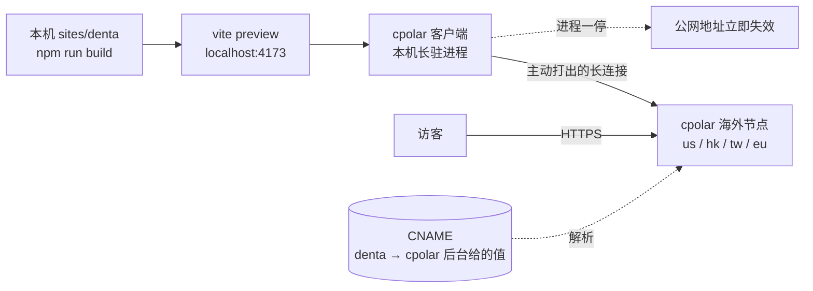

# Denta(denta.<BASE_DOMAIN>)

> 🚇 这一站不是常驻站点。它跑在作者本机上,靠 cpolar 穿透到公网——**机器关了就打不开**,这是内网穿透的性质,不是故障。定性见 [02 · 内网穿透](../guide/02-tunneling/README.md#它不是托管是-stage-环境)。
>
> 站点:[`sites/denta`](../../sites/denta) · 部署:cpolar 隧道(本机 `localhost:4173`)· 素材:MotionSites prompt 库
>
> 📖 这条链路怎么搭的,完整步骤在 [cpolar 篇](../guide/02-tunneling/cpolar.md);为什么公网找得到你的机器,在 [08 · 内网穿透的原理](../basics/08-tunneling.md)。
>
> 本篇是第三个示范站的实战。通用原理不重复,随文引用 [02 · 内网穿透](../guide/02-tunneling/README.md)。

## 成品与架构

一个虚构牙科问诊 App 的落地页:暖杏底色的单页站,中间把 app 的三块真实界面(选服务 / 引导 / 视频问诊)装进手机框摆出来。React 19 + TS + Vite + Tailwind v4,零路由。



## 一、壳与芯分离:这一站的拼装法

前两站各示范了一个方向——Reverie 是**一份整页规格摊成八页**,Acreage 是**五份区块规格收成一页**。这一站是第三种:**壳和芯来自完全不同的 prompt。**

### 1. 先认清:分类会骗人,`kind` 字段更会

想做"介绍 app 的前端",检索到 `dental-care-app`(分类 `Health App`)时看着完美。拉全文才发现它的标题是 `Denta — App Screens (Standalone)`:

```html
<title>Denta — App Screens (Standalone)</title>
<style>body{ display:flex; align-items:center; justify-content:center; overflow:hidden }</style>
<div id="row">  <!-- 三块 511×1137 的手机屏并排,末尾一段 JS 按窗口缩放 -->
```

**它不是网站,是三块 app 屏幕稿**——不能滚动,没有页面结构。同族的 `dental-implant-clinic` 一样,标题直接写着 `SmileLab - Phone Mockups`。

注意:这两条的 `kind` 字段都是 `website`。**全库的 `kind` 都是 `website`**,`list_prompts` 的 `kind=app` 过滤器返回空数组。分类名(`Health App` / `Mobile App`)也只描述题材,不描述形态。**形态只能靠拉全文判断。**

### 2. 分头找壳:题材对口的"整页规格"在另一条上

屏幕稿是"芯",还缺一个"壳"。壳的判据和 Acreage 那次一样——**规格里有没有规定区块顺序与页面节奏**。

`health-portal`(分类 `Landing Page`,免费)开头第一句就是答案:

> Create a single-page **dental clinic landing page** using React + Vite + TypeScript + Tailwind CSS.

题材同域、技术栈与本项目一模一样、规格密度极高(精确到 `cubic-bezier(0.16,1,0.3,1)`、每级延迟 120ms、`clamp(3rem,11vw,11rem)`、`leading-[0.79]`)。壳定了。

### 3. 壳给结构,芯给内容,谁都不改对方

| 来源 | 贡献什么 | 没贡献什么 |
|---|---|---|
| `health-portal` | 三段全屏的节奏、固定导航与移动抽屉、MaskedCard 马赛克、错峰揭示 | 全部文案(它写的是诊所,我们写的是 app) |
| `dental-care-app` | 三块 app 屏、品牌名 Denta、暖杏色板 `#FAE0CD`、logo | 页面结构(它根本没有) |
| `dental-implant-clinic` | 手机外框(灵动岛 + 底部指示条)、四组入场关键帧 | 品牌(它是另一家 SmileLab,配色是蓝的,只借结构) |
| `faq-cta` | FAQ 手风琴、`@property` 活体渐变、页脚 | 原配色(五团荧光色斑,换成了暖杏系) |

两套品牌只能留一个。Denta 的暖杏 `#FAE0CD` 与前两站(Reverie 的暗雾、Acreage 的商务绿)距离更远,SmileLab 的蓝被砍掉,只留外框。

### 4. MaskedCard:多张卡片共用一张底图

`health-portal` 最值钱的一手。首屏四张卡片不是各配一张图,而是**同一张照片被卡片间距切开**——每张卡只是这张图上的一扇窗:

```ts
const overflow = imageWidth > position.sw ? imageWidth - position.sw : 0
const focalOffset = overflow * focalX
// 底图按区块高度铺满,每张卡把 backgroundPosition 偏到自己该在的位置
backgroundSize: `auto ${position.sh}px`
backgroundPosition: `-${position.x + focalOffset}px -${position.y}px`
```

卡片位置靠 `ResizeObserver` 实时量。实现见 [`src/lib/useMaskedMosaic.ts`](../../sites/denta/src/lib/useMaskedMosaic.ts)。

**规格没写、但必须加的一条**:本站加载四套 Google Fonts,字体换上后文字尺寸变化会推着卡片挪位,而区块本身是 `h-screen` 高度不变——`ResizeObserver` 观察不到。所以额外挂一次 `document.fonts.ready` 重量,否则首屏定格在字体未就位时的错位上。

### 5. 屏幕稿照抄坐标,靠"设计稿画布"塞进手机框

三块屏原稿是 511×1137 / 511×1137 / 523×1135 的绝对定位,数值精确到 `left:-70px`(那条 Dentist 胶囊是**故意**探出左边界的,表达"这排还能横滑",别顺手推回来)。

不重算这些坐标,而是照 `glassmorphic-feature-tabs` 里 `TabDashboardMock` 的做法:**内容按原稿坐标画在固定尺寸的画布上,整块等比缩放到屏幕里**。`PhoneFrame` 因此收 `designWidth` / `designHeight` 两个参数,三块屏各报各的。

## 二、最大的教训:Tailwind 的 preflight 会悄悄改掉超宽图

引导屏那块的底图是刻意超宽的——舞台 870px,图 2712px,靠 `left:-1336px` 把人脸推到取景框里。做出来那块屏却只剩一片底色。

不是图挂了(`naturalWidth` 是 1342,加载正常),而是量出来渲染宽度只有 293px。反推:

```
293 ÷ (0.78 整机缩放 × 0.687 画布缩放 × 0.629 舞台缩放) ≈ 870
```

**正好是舞台宽度。** Tailwind preflight 给 `img` 设了 `max-width: 100%`,把 2712px 钳成了父容器的 870px。加 `max-w-none` 解决。

这个坑的形状值得记住:**图片加载成功、尺寸样式也写了、就是不对**——先量 `getBoundingClientRect()` 反推缩放链,别盯着 `src` 查。

另外两处偏离原稿的地方,都是照做会出问题才改的:

- **首屏三条横幅的文字从居中改成左对齐**。原稿居中,但底图里人在右侧,居中正好压在脸上读不清
- **窄屏首屏加了三段式遮罩**。390px 宽只看得到底图约 28% 的宽度,白背景和人脸进不来同一个窗口(试过往左收,只剩头发)。于是让人脸当主体,顶部提亮托住深色小字、中段透明、底部压暗托住白色大标题
- **开场那段 0→100 读秒没有采用**(规格里有)。它挡住首屏近 3 秒,换来的只是一个数字

## 三、部署链路

| 项 | 值 | 出处 |
|---|---|---|
| provider | `cpolar`(专业版) | 绑自有域名需专业版及以上 |
| 本机端口 | `4173` | `site.yaml` 的 `localPort`,与 `infra/tunnel/cpolar.example.yml` 一致 |
| region | `us` / `hk` / `tw` / `eu` 之一 | `<BASE_DOMAIN>` 未备案,**默认的 `cn_top` 是大陆节点会被拒** |
| HTTPS | 自备 `crt` / `key` | cpolar 不给自有域名签发证书 |
| 可达性 | 本机 cpolar 客户端在线时 | `availability: best-effort` |

🔴 **两个必配项**,不配就是"隧道显示已连接、访客却打不开":

1. `vite.config.ts` 的 `preview.allowedHosts` 要放行隧道域名,否则 Vite 自己回 403 `Blocked request`
2. 隧道回源地址写 `http://localhost:4173` 而不是 `127.0.0.1` —— `vite preview` 只监听 `[::1]`

两条的实测输出见 [02 档导读](../guide/02-tunneling/README.md#动手前两个所有链路都会撞上的拦路虎)。

## 四、上线核验清单

```bash
cd sites/denta && npm run build                    # ① 本地构建绿(tsc 严格检查 + vite build)
npm run preview -- --port 4173 --strictPort        # ② 端口被占时失败得响亮,不静默换端口
curl -s -o /dev/null -w '%{http_code}\n' http://localhost:4173/          # ③ 本机 200
curl -s -o /dev/null -w '%{http_code}\n' -H 'Host: <隧道域名>' http://localhost:4173/  # ④ 仍是 200 = allowedHosts 配对了
```

再用浏览器(带手机)真开一遍:

- [ ] 首屏四张卡拼成一张完整照片,不是四张各自的图
- [ ] 三块手机屏都有内容——引导屏那块尤其要确认底图在,不是一片底色
- [ ] 窄屏三台手机能横滑,页面本身不能左右滚
- [ ] 移动抽屉能开能关,开时背景不跟着滚
- [ ] FAQ 逐条能展开

---

**学会原理后,一条命令搞定**:`npx golive tunnel denta` 打印的步骤与本篇部署段一一对应(隧道站不走 `golive deploy`,它是本机长驻进程不是一次性发布)。素材溯源(prompt 编号、资产形态)登记在 [`site.yaml`](../../sites/denta/site.yaml)。
